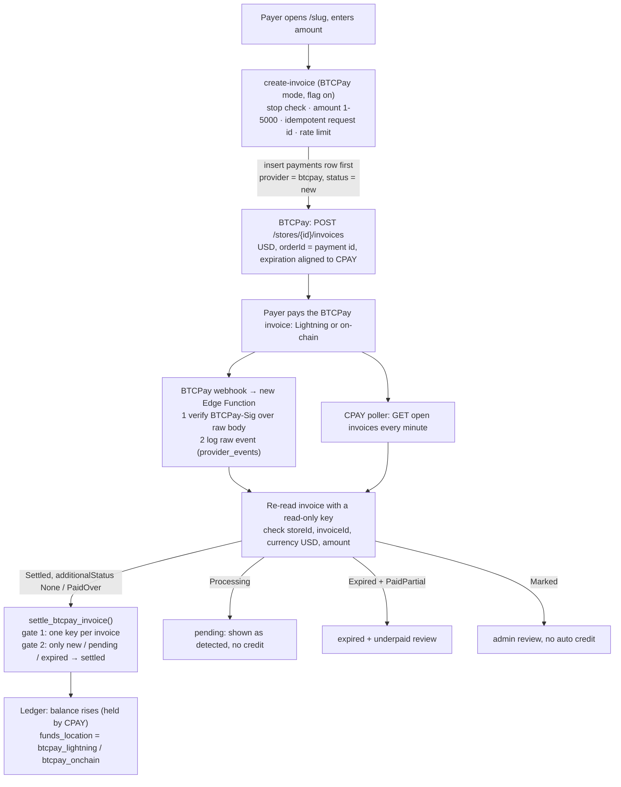
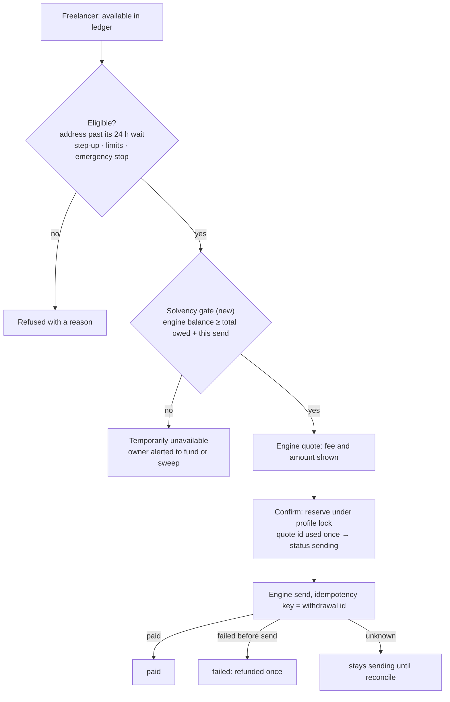

# BTCPay Server receiving + wallet-engine withdrawals: architecture and money flow

Status: **design only, 2026-10-17.** Nothing in this document is deployed or wired up.

- No BTCPay server, store, API key, webhook or secret exists for CPAY.
- No code in the repository talks to BTCPay.
- The production receive path (the wallet engine) and the USDT withdrawal path are unchanged.
- No feature flag described here exists yet. Each one is proposed with a default of **off**.

"Wallet engine" means CPAY's one platform wallet: the Spark wallet SDK, run by the wallet Edge Function (production)
or `payment-service/` (self-hosted fallback). See [ARCHITECTURE.md](ARCHITECTURE.md) and
[CPAY_CURRENT_ARCHITECTURE.md](CPAY_CURRENT_ARCHITECTURE.md).

## The short answer

**BTCPay never funds the wallet engine by itself.** BTCPay's on-chain store wallet and its Lightning backend
are wallets of their own, separate from the engine's Spark wallet. Money received by BTCPay can pay a CPAY
withdrawal only after a real transfer from the BTCPay side into the engine. That transfer is a Lightning
payment to an invoice the engine created, or an on-chain payment to the engine's deposit address. The
alternative is for the owner to fund the engine by hand.

There is **no verified automatic bridge today.** Every bridge option below is either untested end to end or
needs CPAY code that does not exist yet. Until one is built and proven, **a BTCPay receipt credited to a
freelancer's CPAY balance cannot be withdrawn automatically.** CPAY must not treat that ledger balance as
proof that the engine can pay it.

## 1. How money moves today (verified in the repository at `main` 5ac60f4)

### Receive

1. A payer opens `/<slug>`.
2. `create-invoice` makes the payment row before any invoice exists, after these checks:
   - the emergency stop (fails closed);
   - the amount range, $1 to $5000;
   - idempotency on (link, request id);
   - rate limits.
3. It then asks the engine for a BOLT11 (`supabase/functions/create-invoice/index.ts`).
4. The engine prices the invoice in sats and attaches it only to a row that is still `new` (`payment-service/ledger.mjs`).
5. Settlement arrives from SDK events plus a catch-up scan every minute. Both call
   `settle_breez_payment(id, payment_hash, amount_sat)`
   (`supabase/migrations/20261003030000_restore_lightning_receipt_behavior.sql`), which credits exactly once
   through two gates:
   - a unique `webhook_events.delivery_id` per engine payment id;
   - an update that only moves `new | pending | expired` rows to `settled`, and only when enough sats arrived.
6. Receipts that match nothing are only flagged, never credited (`receipt_reviews`, migration 20261007130000):
   - `unknown` becomes `unmatched`;
   - a receipt without a payment hash (for example an on-chain deposit) becomes `no_hash`.

### Balance

`get_balance_for()` is computed from the ledger only:

- settled `amount_settled − platform_fee_amount`;
- minus withdrawals that are not `rejected` or `failed`.

No wallet balance is involved. The website says so: the balance is **held by CPAY**.

### Withdraw (USDT)

1. **Quote.** `withdraw.mjs` checks:
   - the amount against the ledger `available`;
   - the saved address, after its 24-hour wait;
   - that the engine holds **this one withdrawal's** sats (`getInfo().balanceSats`).
2. **Confirm.**
   - `user-withdraw` checks the JWT and step-up.
   - The engine claims the quote once.
   - `reserve_stablecoin_withdrawal()` locks the profile, returns the existing row if the quote id was
     already used, re-checks the emergency stop, limits and balance, and inserts `sending`.
   - `sendPayment` runs with idempotency key = the withdrawal id.
3. **Finalize.**
   - `finalize_stablecoin_withdrawal()` only moves `sending`, so a failure refunds once.
   - Trigger `guard_withdrawal_balance` refuses any row that makes `available < 0`.

### The gap that matters for BTCPay

User withdrawals have **no aggregate solvency check**. Nothing compares the engine balance with the total
owed to all freelancers.

- Admin wallet sends are guarded by `spendable = engine balance − owed` (`wallet.mjs`).
- User withdrawals only check that one withdrawal fits (`withdraw.mjs`).

Today that is safe, because every receipt lands in the engine. Once BTCPay receipts are credited to the ledger
while the money sits in BTCPay's wallets, withdrawals would be paid first come, first served until the engine
runs dry. After that, quotes fail with "temporarily unavailable". **This gate must exist before any BTCPay
credit is withdrawable** (section 6, step 0).

## 2. BTCPay Server facts that the design relies on

Checked in BTCPay's source repositories (`btcpayserver/btcpayserver` master `70c07d3`,
`btcpayserver/btcpayserver-doc` `82eda1c`). The rendered docs site was blocked from this environment. A
deployed BTCPay may be older: check `GET /api/v1/server/info` and its `/docs` before relying on exact names.

### Custody

- BTCPay is self-hosted invoicing software. Payments go to the merchant's own wallets, not to the BTCPay project.
- **On-chain:**
  - a **watch-only** store wallet (xpub) can receive but not sign;
  - a **hot** store wallet keeps its key on the BTCPay server.
- **Lightning is always hot.** It runs on whatever backend the store connects:
  - an internal node (LND, Core Lightning, Eclair) or an external node;
  - a custodial service or a swap plugin;
  - a Spark-based plugin (below).

### API

| | |
|---|---|
| Auth | `Authorization: token <key>`. Keys can be limited to one store and to listed permissions |
| Create invoice | `POST /api/v1/stores/{storeId}/invoices`, permission `btcpay.store.cancreateinvoice`. Fields: `amount`, `currency` (`USD`), `metadata.orderId`, `checkout.expirationMinutes` (store default 15), `checkout.monitoringMinutes` (default 1440), `checkout.speedPolicy`, `checkout.paymentMethods` (`BTC-LN`, `BTC-CHAIN`) |
| Read invoice | `GET /api/v1/stores/{storeId}/invoices/{invoiceId}` (`canviewinvoices`) |
| Statuses | `status`: `New, Processing, Expired, Invalid, Settled`. `additionalStatus`: `None, PaidLate, PaidPartial, Marked, Invalid, PaidOver`. Always read both |
| Speed policy | `HighSpeed` 0 confirmations, `MediumSpeed` 1, `LowMediumSpeed` 2, `LowSpeed` 6. Lightning settles at once |
| Never grant CPAY | `btcpay.store.canmanageinvoicestatus` (manual marking) |

### Webhooks

- **Events:** `InvoiceCreated, InvoiceReceivedPayment, InvoicePaymentSettled, InvoiceProcessing,
  InvoiceExpired, InvoiceSettled, InvoiceInvalid`.
- **Signature:** header `BTCPay-Sig: sha256=<hex HMAC-SHA256(secret, raw body)>`. Verify it over the raw bytes,
  in constant time, before parsing.
- **Settle events carry no amount or status.** The credit must come from re-reading the invoice.
- **Retries:**
  - after 10 s, after 1 min, then 6 times every 10 min;
  - only 5xx, 408, 429 and network errors are retried; **any other 4xx is never retried**;
  - **every retry has a new `deliveryId`** (`originalDeliveryId` keeps the first). Deduplicating on
    `deliveryId` alone lets retries through.

### Payouts (BTCPay sending from its own wallets)

- `POST /api/v1/stores/{storeId}/payouts` with `payoutMethodId` `BTC-LN` (BOLT11/LNURL) or `BTC-CHAIN`.
- Automated processors:
  - Lightning pays from the store's Lightning connection, and cancels if the BOLT11 amount does not match or
    has expired;
  - on-chain **requires a hot wallet**.
- Direct Lightning pay: `POST /api/v1/stores/{storeId}/lightning/BTC/invoices/pay`. The permission name
  differs between the API description and the code; test it on the deployed version.
- A watch-only store can only be swept by signing outside BTCPay: an unsigned PSBT from
  `…/payment-methods/BTC-CHAIN/wallet/transactions`, signed on a hardware wallet.

### Spark-based BTCPay plugins

Two community plugins exist. **Neither can safely share the engine's wallet.**

- One, by Kukks, is built on the SDK's older Greenlight flavour, a different wallet type.
- **Flint** (Seth For Privacy) runs the same Spark SDK inside BTCPay, with one Spark wallet per store. It is
  about two months old and has a single maintainer. Its README says it is written by AI, and its own
  limitations page warns that two servers on one recovery phrase "can sweep twice".
- Importing CPAY's mnemonic into BTCPay would:
  - put the platform's only seed on a second server;
  - escape CPAY's one-holder lease;
  - break the engine's exactly-once send logic.

## 3. The funding bridge: options

| Option | How money reaches the engine | What CPAY must build | Main risks | Status |
|---|---|---|---|---|
| **A. Lightning sweep** | BTCPay's Lightning backend pays a fixed-amount BOLT11 created by the engine. Either CPAY calls BTCPay's Lightning pay API, or a BTCPay `BTC-LN` payout plus the automated processor sends it | An automated "bridge invoice" route on the engine (today only an admin route exists); a `treasury_transfers` record; lookup-before-retry by payment hash | A BTCPay key with **spend power** stored in CPAY; route or liquidity failures; payout amount must match the BOLT11 exactly | Mechanism documented in source; **not tested end to end** |
| **B. On-chain sweep** | BTCPay store wallet sends to the engine's static on-chain deposit address; the engine claims the deposit after 3 confirmations | Expose the deposit address; set the SDK's `maxDepositClaimFee`; handle `UnclaimedDeposits`; an admin claim/refund route | **SDK 0.26.0 default claim ceiling is 1 sat/vB**, usually too low, so a deposit can sit unclaimed with no alert (CPAY ignores the event today); automation needs a hot wallet; about 30 min or more | Mechanism documented; **CPAY support missing** |
| **C. Owner funding (no automatic bridge)** | The owner tops up the engine from their own funds, by any route | An aggregate **solvency gate** on quote and confirm (`engine balance ≥ total owed`); a health alert; a `treasury_transfers` record per top-up | Freelancers see "temporarily unavailable" while underfunded; price risk | Gate **missing**; policy decision |
| **D. Same wallet** | BTCPay (Flint) imports the engine's mnemonic | Nothing to bridge | Two live instances on one wallet can double-spend; second copy of the seed | **Not recommended** |

**Recommendation.**

1. Start with **C**: owner funding, a solvency gate and alerts. It needs the least new key exposure.
2. Then add **A** as an owner-triggered sweep, small and capped, with the BTCPay spend key used only by that
   job.
3. Use **B** only after the claim-fee settings are fixed and an unclaimed-deposit alert exists.
4. Do not use **D**.

## 4. Money-flow diagrams

### Customer → BTCPay invoice → confirmed payment → CPAY ledger



### Available funds → withdrawal → final settlement



### The bridge between BTCPay and the engine

```mermaid
flowchart LR
  subgraph BTCPay side, owner's wallets
    LN[Lightning backend]
    OC[On-chain store wallet]
  end
  subgraph CPAY wallet engine
    EN[Spark wallet]
  end
  LN -->|"A: pay engine BOLT11 (fixed amount, once)"| EN
  OC -->|"B: send to deposit address, claim after 3 conf"| EN
  OW[Owner's own funds] -->|"C: manual top-up"| EN
  EN -. each transfer recorded in treasury_transfers, never in freelancer balances .- TT[(treasury_transfers)]
```

## 5. Provider abstraction (proposed, not built)

### Interface (TypeScript, in `supabase/functions/_shared/`)

```ts
interface ReceiveProvider {
  id: 'wallet_engine' | 'btcpay';
  createInvoice(p: { paymentId: string; amountUsd: string; expiresMinutes: number }): Promise<{
    providerInvoiceId: string; bolt11?: string; onchainAddress?: string; checkoutUrl?: string; expiresAt: string;
  }>;
  getInvoice(providerInvoiceId: string): Promise<NormalizedInvoiceState>;   // the only source of truth for a credit
  verifyWebhook?(rawBody: Uint8Array, headers: Headers): Promise<boolean>; // constant-time HMAC
}
type NormalizedInvoiceState = {
  status: 'new' | 'pending' | 'settled' | 'expired' | 'invalid';
  providerStatus: string; providerAdditionalStatus: string | null;
  currency: 'USD'; amount: string; paidAmount: string | null;
  manuallyMarked: boolean; settledAt: string | null;
};
```

### Normalized payment record

Extend `payments`, so RLS, triggers, `get_balance_for()` and the desk keep working.

| Column | New? | Notes |
|---|---|---|
| `provider` | new | `wallet_engine` (default, today's rows) or `btcpay` |
| `provider_store_id` | new | BTCPay `storeId`; the store binding check |
| `invoice_ref` | existing | BTCPay `invoiceId` or the engine payment hash; uniqueness widened to `(provider, invoice_ref)` |
| `method` | existing | `lightning` or `onchain` (relax the `method = 'lightning'` CHECK) |
| `payment_hash`, `lightning_invoice`, `onchain_address`, `checkout_url` | some new | payment references |
| `currency` | new | must stay `USD` |
| `amount_requested`, `amount_settled` | existing | credit = `amount_requested`, as today |
| `paid_amount_provider`, `received_sat`, `btc_usd_rate`, `amount_sat` | partly new | received amount and rate, for audit and fees |
| `status` | existing | mapped from the provider; the transition trigger is unchanged |
| `provider_status`, `provider_additional_status`, `speed_policy` | new | raw values, for audit |
| `expires_at`, `monitoring_expires_at`, `first_seen_at`, `settled_at` | partly new | timestamps |
| `settlement_source` | new | `engine_event`, `engine_catchup`, `btcpay_webhook`, `btcpay_poll`, `admin` |
| `funds_location` | new | `wallet_engine`, `btcpay_lightning`, `btcpay_onchain`; drives the solvency view |
| reconciliation outcome | existing | `receipt_reviews` rows (`unmatched`, `no_hash`, `underpaid`, `overpaid`, `already_settled`) |

### Companion tables

- **`provider_events`** (service role only), the raw webhook log:
  - columns: `provider, store_id, webhook_id, delivery_id, original_delivery_id, is_redelivery, type,
    invoice_id, received_at, signature_ok, outcome`;
  - unique on `delivery_id`, for audit only; the credit key is per invoice.
- **`treasury_transfers`**:
  - columns: `direction` (`btcpay_to_engine`, `owner_to_engine`, `engine_to_owner`), `rail`, `amount_sat`,
    `btc_usd_rate`, payment hash, BOLT11 or `txid:vout`, BTCPay payout id, engine payment id, `status`
    (`created, sent, received, failed, unknown`), `created_by`, timestamps, note;
  - it closes the `unmatched` / `no_hash` reviews a top-up creates;
  - **it never changes a freelancer balance.**

### Proposed flags (`app_settings`, set through `admin_set_feature_toggle()`, audited, all default off)

| Key | Default | Effect |
|---|---|---|
| `receive_provider` | `"wallet_engine"` | Which provider `create-invoice` uses. `"btcpay"` only after review |
| `btcpay_receive_enabled` | `false` | Master switch for the BTCPay webhook and poller. Off means webhooks answer 503, which BTCPay retries, and nothing is credited |
| `withdraw_solvency_gate` | `false`, then `true` before any BTCPay credit | Refuse quotes and confirms unless `engine balance ≥ total owed + this send` |
| `treasury_sweep_enabled` | `false` | Allows the owner-triggered bridge job (option A) |

Keep the existing `emergency_payments_stop` and `emergency_withdrawals_stop` above all of these.

## 6. Webhook verification and reconciliation (the procedure to implement)

0. **Before anything else:**
   - delete the orphan deployed `reconcile` Edge Function that still calls BTCPay, and the legacy `BTCPAY_*`
     secrets ([OPS_DRIFT_2026-10.md](OPS_DRIFT_2026-10.md));
   - add the solvency gate and a health alert `engine balance < total owed`.
1. **Endpoint:** a new Edge Function with JWT verification off and a body limit. With
   `btcpay_receive_enabled` off, answer 503.
2. **Verify:** read the raw bytes, compute HMAC-SHA256 with the store's secret, and compare in constant time
   against `BTCPay-Sig`. On a mismatch, answer **401**. BTCPay does not retry it, and the event is logged.
3. **Log** the event in `provider_events`.
4. **Re-read the invoice** with a read-only key. Never credit from payload fields. Require all of:
   - `storeId` equals the stored `provider_store_id`;
   - `invoiceId` equals `invoice_ref`;
   - `currency` is `USD`;
   - `amount` equals `amount_requested`;
   - `metadata.orderId` equals the payment id.
5. **Settle** with `settle_btcpay_invoice()`, a twin of `settle_breez_payment()`. Same two gates, with the
   credit key `btcpay:settle:<invoiceId>` (**one per invoice, not per delivery**). Map the invoice state:
   - `Settled` (`None` or `PaidOver`): credit; `PaidOver` is also flagged `overpaid`;
   - `Processing`: `pending`, no credit;
   - `Expired` + `PaidPartial`: `underpaid` review;
   - `Marked`: admin review, never an automatic credit;
   - `Invalid` after a credit: admin review, because the trigger refuses `settled → invalid` without an admin.
6. **Answer:**
   - 2xx only when the event is fully processed or deliberately ignored;
   - **5xx for anything retryable** (database down, BTCPay read failed).

   The removed BTCPay webhook in this repository returned 404 to "retry". Current BTCPay never retries a 404.
7. **Poller:** every minute, re-read open BTCPay invoices (`new`, `pending`, recently `expired`), the same way
   today's catch-up scan works. A missed webhook, or BTCPay retrying for only about 71 minutes, cannot lose a
   credit.
8. **Late payments:** CPAY already allows `expired → settled`. Credit at the original USD price, or hold for
   review. That is an owner decision.
9. **Confirmations:** never credit on `Processing`. Use at least `MediumSpeed` (1 confirmation) for on-chain,
   with more for large amounts.

### Exactly-once guarantees

- **A payment is credited at most once:**
  - one credit key per invoice (unique index);
  - the status gate `new | pending | expired → settled`;
  - the transition trigger;
  - all three already exist for the engine and are proven in CI ([FINANCIAL-INVARIANTS.md](FINANCIAL-INVARIANTS.md)).
- **A withdrawal is sent at most once:** unchanged:
  - quote id used once;
  - profile lock;
  - SDK idempotency key = withdrawal id;
  - finalize moves only `sending`.
- **A bridge transfer is sent at most once:**
  - a fixed-amount BOLT11 is created and stored before paying, and a paid hash cannot be paid again;
  - look up by payment hash, or by BTCPay payout id, before any retry;
  - on-chain: one row per transfer and never a blind rebroadcast.

## 7. Configuration and secret inventory (names only)

| Secret / setting | Where | Purpose |
|---|---|---|
| `BTCPAY_URL` | Edge secret | Base URL of the owner's self-hosted BTCPay |
| `BTCPAY_STORE_ID` | Edge secret | The one store CPAY uses |
| `BTCPAY_API_KEY_INVOICES` | Edge secret | `cancreateinvoice` + `canviewinvoices` only, limited to the store |
| `BTCPAY_WEBHOOK_SECRET` | Edge secret | HMAC secret of the one webhook |
| `BTCPAY_API_KEY_SWEEP` | Edge secret, bridge job only | Lightning pay or payout permission; created only if option A is approved |
| `PAYMENT_SERVICE_SECRET`, the engine's own secrets | existing | Unchanged; never shared with BTCPay |

Rules:

- The repository is public, so no value ever goes in code, docs or logs.
- The legacy `BTCPAY_*` names from the removed integration must be deleted before new ones are created.

## 8. Failure recovery and rollback

- **BTCPay down:**
  - invoice creation fails closed, with "try again" for the payer;
  - with `receive_provider` switched back to `"wallet_engine"`, new invoices use today's path at once;
  - open BTCPay invoices keep settling through the poller once BTCPay is back.
- **Webhook endpoint down:** BTCPay retries for about 71 minutes, and the poller covers the rest.
- **A wrong credit:** an admin moves the row, as today. `settled → invalid` is admin-only and audited.
- **Bridge transfer stuck:**
  - Lightning `unknown`: look up by payment hash on both sides before any retry;
  - on-chain unclaimed deposit: an admin claim or refund.

  The ledger is untouched either way.
- **Rollback:**
  - turn `btcpay_receive_enabled` off and set `receive_provider` to `"wallet_engine"`;
  - keep the webhook answering 503, so BTCPay keeps retrying instead of dropping events;
  - migrations stay forward-only, and new columns are additive and nullable.

## 9. Testing plan (no mainnet money in automated tests)

- **Unit:**
  - HMAC verification over raw bytes, including a wrong secret, a changed byte and a missing header;
  - status mapping, including every `status` × `additionalStatus` pair;
  - credit key per invoice, so a retry with a new `deliveryId` credits nothing.
- **SQL in CI:** `settle_btcpay_invoice()` twin tests, written like `ci/financial_invariants_test.sql`:
  concurrent duplicates, replay, partial, over, late and marked invoices.
- **E2E on the disposable stack:** a fake BTCPay (like today's fake wallet SDK) that serves the invoice API
  and sends signed webhooks.
- **Integration:** a self-hosted BTCPay on **regtest** (BTCPay's docker setup), a regtest Lightning node, and
  the engine on regtest. Exercise options A and B there before any owner decision on mainnet.
- **Mainnet:** only a small owner-approved test. Never in CI.

## 10. Owner decisions still open

1. **Lightning backend for BTCPay:**
   - your own LND or Core Lightning (needs liquidity management);
   - Flint (young, separate seed);
   - a custodial service;
   - on-chain only.
2. **On-chain store wallet:** watch-only with manual signing (safer), or hot (enables automation; the key sits
   on the server).
3. **Self-hosted BTCPay, or a third-party host.** BTCPay's docs warn against hot wallets on third-party hosts.
4. **The bridge:** A, B or C, plus the threshold, the cadence, and who triggers it.
5. **Withdrawability:** are BTCPay credits withdrawable at once (needs an engine float), or only once bridged
   (a "settled, not yet funded" state shown to the freelancer)?
6. **The solvency rule:** a hard gate, or an alert only.
7. **Payment windows:** speed policy, invoice expiry (align with CPAY's 60 minutes), monitoring window,
   payment tolerance.
8. **Partial, over and late payments:** credit, refund or review.
9. **Providers:** keep the engine's receive path as a fallback or per-link choice, or use BTCPay only.
10. **Price risk:** BTC/USD movement between receipt, bridge and USDT payout.
11. **Custody and legal review:** for a second set of keys (BTCPay) next to the engine.
12. **Engine hardening:** needed even without BTCPay if the engine is ever funded on-chain:
    - set `maxDepositClaimFee`;
    - alert on unclaimed deposits;
    - consider the SDK's treasury settings (real-time sync off, longer sync interval).

## 11. What could not be verified

- **The rendered docs sites.** `docs.btcpayserver.org` and the Spark SDK and Spark docs sites were blocked
  here. Facts were read from their public source repositories instead.
- **Spark fee figures.** These came from a search summary only. Use the SDK's fee quotes at run time.
- **Versions and behaviour:**
  - BTCPay retry behaviour, per-retry delivery ids and the `BTC-LN` / `BTC-CHAIN` ids were checked on current
    master only;
  - the Lightning pay permission name differs between BTCPay's API description and its code.
- **Payouts:**
  - whether a BTCPay payout can be made idempotent, or matched exactly to a BOLT11 amount;
  - whether two Spark SDK instances on one recovery phrase can send safely. Flint's docs say no.
- **Production:** whether the production engine would claim an on-chain deposit at today's fee rates. Nothing
  in production was contacted for this document.
